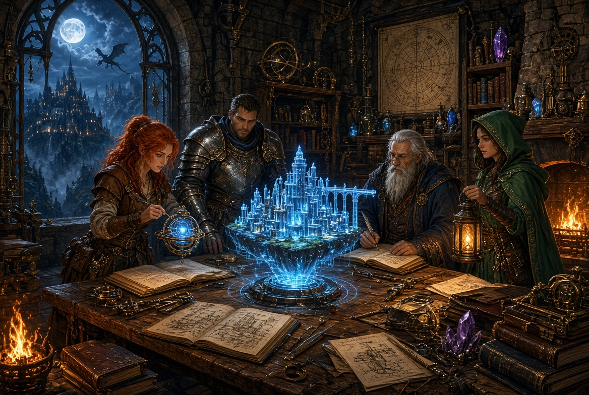
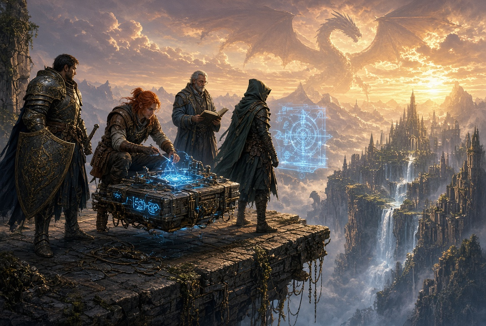

# Artwork gallery

Ray selected four artwork files for this public snapshot. They show the fantasy Skybridge and workshop concepts developed with AI assistance.

These are game concept illustrations. Depicted devices, holograms, magic, and structures are fictional visual material. Current scene inputs and conditional calculations come from the [v0.3 playtest packet](UI-Worlds-Playtest-v0.3.md).

## Skybridge to the lost mountain city — PNG

Adventurers investigate a crossing in a mountain world.

[Open uploaded PNG](../Skybridge%20to%20the%20lost%20mountain%20city-1.png)

## Moonlit workshop of wonders — PNG

Adventurers collaborate around maps, notes, and an inventive workshop.

[Open uploaded PNG](../Moonlit%20workshop%20of%20wonders-2.png)

## Workshop — JPEG

A moonlit workshop scene with a shared map and a glowing model of a city.

[Open uploaded JPEG](../UCQqr.jpg)

## Skybridge — JPEG

Adventurers examine a floating platform above a ravine beneath a dragon-filled sky.

[Open uploaded JPEG](../Uzst0.jpg)

The [artwork manifest](../media/artwork-manifest.json) records the filenames, sizes, and hashes of these four published files.
